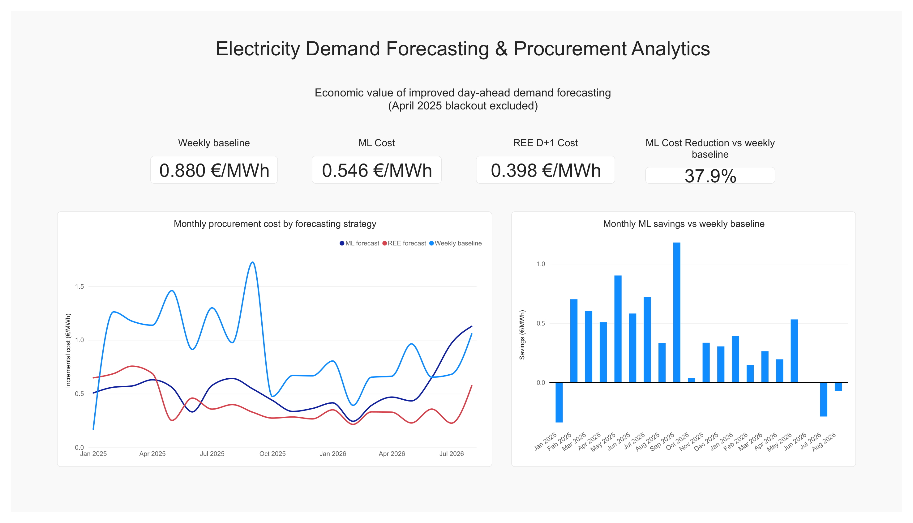
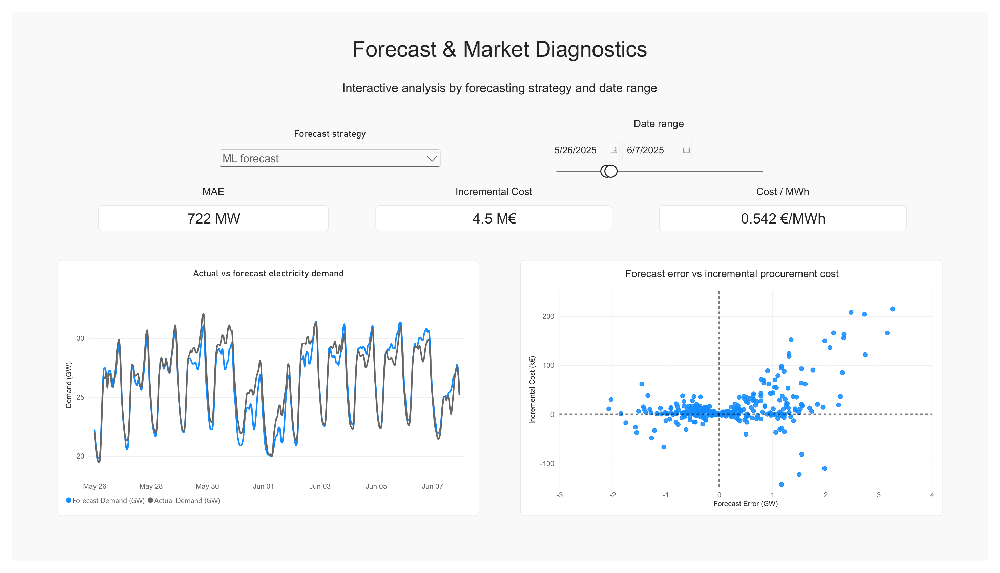

# Energy Demand Forecasting & Procurement Analytics

End-to-end day-ahead electricity demand forecasting and procurement analytics for the Spanish power system.

The project combines electricity demand, operational weather forecasts, machine learning, market prices, PostgreSQL, and Power BI to answer a practical question:

> **How much economic value does a better electricity-demand forecast create?**

The forecasting problem is treated as a genuinely ex-ante problem: every feature used to forecast day **D** must be available by **12:00 local time on D-1**.

---

## Project overview

The pipeline covers the complete path from raw data to business reporting:

**REE / ESIOS + GFS data → feature engineering → temporal validation → demand forecasting → procurement backtest → PostgreSQL → Power BI**

Three forecasting strategies are compared:

1. **Weekly baseline** — demand from 168 hours earlier.
2. **ML forecast** — HistGradientBoostingRegressor using demand history, calendar effects, regional holidays, and weather forecasts.
3. **REE D+1 forecast** — the Spanish system operator's official day-ahead demand forecast.

The main result is that the ML model substantially improves on the weekly baseline, both statistically and economically, while the official REE forecast remains the strongest benchmark.

---

## Key results

### Forecast accuracy

Normal-operation test period: **January 2025 – August 2026**

| Forecast | MAE |
|---|---:|
| Weekly baseline (`lag_168`) | ~1,372 MW |
| ML forecast | ~763 MW |
| REE D+1 forecast | ~457 MW |

The ML model reduces MAE by approximately **44%** relative to the weekly baseline.

REE's operational forecast remains materially more accurate than the ML model.

### Procurement economics

The same forecasts are evaluated in a hypothetical electricity procurement setting using Spanish day-ahead and imbalance prices.

| Forecast | Incremental procurement cost |
|---|---:|
| Weekly baseline | ~0.880 €/MWh |
| ML forecast | ~0.546 €/MWh |
| REE D+1 forecast | ~0.398 €/MWh |

Relative to the weekly baseline, the ML forecast reduces incremental procurement cost by approximately **38%**.

This corresponds to roughly:

> **€334k of savings per TWh supplied**

under the backtest assumptions.

The economic ranking agrees with the forecasting ranking, but improvements in MAE do not translate one-for-one into procurement savings.

---

## Power BI dashboard

### Executive summary



### Forecast & market diagnostics



The dashboard provides strategy-level and monthly procurement metrics together with interactive hourly diagnostics for demand forecasts, forecast errors, and market costs.

The Power BI `.pbix` file and an exported PDF are available in [`powerbi/`](powerbi/).

---

## Forecasting setup

The task is to forecast every hourly electricity-demand value for day **D** using only information available by:

> **12:00 Europe/Madrid on D-1**

This cutoff is enforced throughout the feature-engineering pipeline.

The final ML feature set includes:

- demand lags: 48h, 168h, 336h, and 504h;
- mean recently observed demand before the forecast cutoff;
- recent demand regime relative to the previous week;
- hour, day-of-week, and month;
- regional holiday-demand exposure;
- D+1 temperature forecasts for eight Spanish cities.

`lag_24` is deliberately excluded because the complete previous day's demand is not yet known at the forecasting cutoff for all target hours.

The final model is a `HistGradientBoostingRegressor`.

---

## Weather data

Weather features are based on the **00 UTC GFS run from D-1**, using 0.25° operational forecasts from NCAR GDEX.

Temperature forecasts are extracted for:

- Madrid
- Barcelona
- Valencia
- Sevilla
- Bilbao
- Zaragoza
- Málaga
- A Coruña

The historical weather archive covers approximately **2016 – August 2026**.

The weather pipeline performs:

- physical temperature-range checks;
- detection of corrupted values;
- temporal-consistency diagnostics across forecast leads;
- explicit missing-lead handling;
- spatial extraction of the nearest GFS grid point;
- interpolation from 3-hourly forecast leads to hourly values;
- timezone-aware selection of the target D+1 local day.

These checks were necessary because some historical forecast files contained corrupted or incomplete observations.

---

## Leakage controls

Avoiding temporal leakage is a central design constraint of the project.

All features are constructed according to what would have actually been known at the forecast origin.

Examples include:

- fixed forecast cutoff at 12:00 D-1;
- no use of unavailable `lag_24` information;
- recent-demand features restricted to observations before the cutoff;
- GFS forecasts taken from an operational run available before day D;
- expanding-window temporal validation;
- no random train/test splitting;
- final 2025–2026 test period excluded from model tuning;
- regional holiday weights estimated from historical demand data only.

The test suite also includes explicit checks for lag causality and the D-1 demand cutoff.

---

## Temporal validation

Hyperparameter selection uses expanding-window validation:

| Validation period | Training data |
|---|---|
| 2021 | before 2021 |
| 2022 | before 2022 |
| 2023 | before 2023 |
| 2024 | before 2024 |

The frozen final model is trained on data through 2024 and evaluated on the untouched 2025–August 2026 test period.

---

## Blackout treatment

The Iberian blackout of **28 April 2025** is treated as an exceptional physical-system event rather than ordinary forecasting error.

Two evaluations are therefore distinguished:

- **all-events performance**, including the blackout;
- **normal-operation performance**, excluding the affected blackout/recovery interval.

The normal-operation exclusion covers 19 affected hours from 28 April to early 29 April 2025.

The exclusion is explicitly flagged in the data rather than silently removing observations.

The main Power BI procurement metrics use the normal-operation definition.

---

## Procurement backtest

For each forecasting strategy, a hypothetical retailer purchases the forecast quantity in the day-ahead market.

Forecast errors generate imbalance settlements:

- actual demand above forecast → shortfall;
- actual demand below forecast → surplus.

The perfect-information benchmark is the cost of purchasing actual demand at the day-ahead price.

The incremental procurement cost is therefore:

```text
actual procurement cost − perfect-information day-ahead cost
```

This allows forecasting performance to be expressed directly in economic terms.

The backtest compares:

- weekly baseline;
- ML forecast;
- official REE D+1 forecast.

The market series are originally available at 15-minute resolution and are aligned to the hourly demand/forecast dataset for the backtest.

---

## Data sources

### REE / ESIOS

| Data | ESIOS indicator | Geography |
|---|---:|---|
| Actual peninsular electricity demand | `1293` | Peninsular Spain |
| REE D+1 demand forecast | `1775` | Peninsular Spain |
| Day-ahead electricity price | `600` | Spain (`geo_id=3`) |
| Upward imbalance price | `763` | Peninsular system (`geo_id=8741`) |
| Downward imbalance price | `764` | Peninsular system (`geo_id=8741`) |

### REData API

Annual electricity demand by autonomous community is used to construct historical regional weights for the holiday-demand exposure feature.

### GFS / NCAR GDEX

Historical 0.25° operational GFS forecasts provide the ex-ante weather information used by the forecasting model.

---

## PostgreSQL analytics layer

Forecasts, market prices, and procurement results are loaded into PostgreSQL before being consumed by Power BI.

### Core tables

- `demand_forecasts`
- `market_prices`
- `procurement_results`

### Analytical views

- `vw_strategy_summary`
- `vw_monthly_costs`
- `vw_monthly_savings`
- `vw_hourly_operations`

Monthly aggregation is performed using the `Europe/Madrid` timezone so that calendar months correspond to the Spanish electricity-market context rather than UTC month boundaries.

SQL definitions and documentation are available in [`sql/`](sql/).

---

## Repository structure

```text
energy-demand-forecasting/
├── data/
│   ├── raw/
│   └── processed/
├── figures/
├── notebooks/
│   ├── 01_ree_data.ipynb
│   ├── 02_weather.ipynb
│   ├── 03_weather_processing.ipynb
│   ├── 04_model_development.ipynb
│   ├── 05_comparison_ree_forecast.ipynb
│   ├── 06_procurement_backtest.ipynb
│   └── 07_sql_analytics.ipynb
├── powerbi/
├── sql/
│   ├── README.md
│   ├── reset_database.sql
│   └── views.sql
├── src/
│   └── energy_forecasting/
│       ├── __init__.py
│       ├── esios.py
│       ├── evaluation.py
│       ├── features.py
│       ├── procurement.py
│       ├── redata.py
│       └── weather.py
├── tests/
│   ├── test_features.py
│   └── test_procurement.py
├── .gitignore
├── pyproject.toml
├── requirements.txt
└── README.md
```

---

## Reproducibility

Raw and processed datasets are not tracked in Git because of their size.

They can be regenerated from the data-acquisition and processing notebooks.

### Environment

Python 3.11 or newer is required.

Create a virtual environment:

```bash
python -m venv .venv
```

Activate it on macOS/Linux:

```bash
source .venv/bin/activate
```

or on Windows PowerShell:

```powershell
.venv\Scripts\Activate.ps1
```

Install dependencies and the local package:

```bash
pip install -r requirements.txt
pip install -e .
```

Run the notebooks in order:

```text
01_ree_data.ipynb
02_weather.ipynb
03_weather_processing.ipynb
04_model_development.ipynb
05_comparison_ree_forecast.ipynb
06_procurement_backtest.ipynb
07_sql_analytics.ipynb
```

Notebook 07 requires access to PostgreSQL.

The connection can be configured through the `ENERGY_DB_URL` environment variable. Local `.env` files are intentionally excluded from Git.

---

## Tests

The project includes lightweight tests for the parts of the pipeline where silent errors would materially change the results.

Current tests cover:

- procurement accounting;
- zero-cost perfect forecasts;
- causal demand lags;
- enforcement of the D-1 demand-information cutoff.

Run:

```bash
pytest -q
```

Expected result:

```text
4 passed
```

---

## Limitations

This is a research and portfolio project rather than a production electricity-trading system.

Important simplifications include:

- weather representation through eight city-level temperature series rather than a full spatial load-weather model;
- simplified procurement and imbalance-settlement mechanics;
- hourly alignment of higher-frequency market-price observations;
- no attempt to reproduce the full information set or operational infrastructure available to REE;
- results should not be interpreted as evidence that the strategy would achieve the same savings in live commercial operation.

These limitations also make the REE D+1 forecast an especially useful real-world benchmark.

---

## Main takeaway

A more accurate demand forecast can create measurable procurement value, but **forecast accuracy is not itself the final business objective**.

In this experiment:

- machine learning substantially improves on a weekly demand baseline;
- the improvement survives translation from statistical error into procurement costs;
- REE's operational D+1 forecast remains materially stronger;
- and the relationship between forecast error and economic cost is nonlinear.

The project therefore connects:

> **data engineering → causal forecasting → temporal validation → market economics → SQL analytics → business reporting**